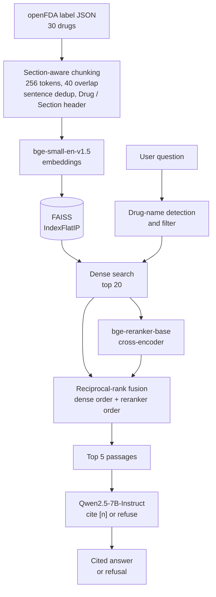

# MedLabel RAG

**Grounded Q&A over FDA drug labels with citations and refusal.**


> **Educational project. Not for clinical use.** Do not use it to make medical decisions.

MedLabel RAG answers questions about 30 FDA drug labels. Every answer cites the label passages it came from, and when the labels do not contain the answer the system says so instead of guessing. The project also includes the evaluation set, scoring code and raw results, so the numbers below can be reproduced.

## Contents
1. [Demo](#demo)
2. [Architecture](#architecture)
3. [Design decisions](#design-decisions)
4. [Evaluation](#evaluation)
5. [What went wrong, and what I tried](#what-went-wrong-and-what-i-tried)
6. [Repository layout](#repository-layout)
7. [Setup and usage](#setup-and-usage)
8. [Limitations](#limitations)
9. [Roadmap](#roadmap)

## Demo

Real outputs from the evaluation run (Qwen2.5-7B-Instruct, A100 40 GB).

**A grounded answer with citations**

```
Q: What is the maximum recommended daily dose of metformin for adults?
A: The maximum recommended daily dose of metformin for adults is 2550 mg per day,
   given in divided doses [2, 3]. Doses above 2000 mg may be better tolerated
   when given 3 times a day with meals [2].
```

**A refusal when the labels do not contain the answer** (ciprofloxacin is not one of the 30 labels)

```
Q: What is the recommended dose of ciprofloxacin for a urinary tract infection?
A (RAG):    I could not find this in the provided labels.
A (no RAG): The recommended dose of ciprofloxacin for a urinary tract infection (UTI)
            in adults is typically 500 mg to 1000 mg once or twice daily ...
```

The second answer is what the same model says without retrieval: confident, with no source behind it.

**A known failure** (see [what went wrong](#what-went-wrong-and-what-i-tried))

```
Q: What is oral semaglutide indicated for?
A: I could not find this in the provided labels.
```

The Indications chunk exists but is not retrieved. The system refuses instead of guessing, which is the safer way to fail.

## Architecture



### Stage by stage

1. **Data.** One label per drug from the openFDA API. The API returns each label as JSON with the sections already split out (indications, dosage, contraindications, warnings, boxed warning, adverse reactions, interactions, pharmacology and others), so no PDF parsing is needed.
2. **Chunking.** Each section is cleaned, repeated sentences within the section are removed, and the text is packed into chunks of whole sentences (256 tokens, 40 tokens of overlap). Chunks never cross a section boundary. Every chunk starts with a header, `Drug: X | Section: Y`, so that a chunk saying "the dose is 5 mg" still says which drug it is about.
3. **Indexing.** Chunks are embedded with `bge-small-en-v1.5` (normalized vectors) and stored in a FAISS inner-product index, which is equivalent to cosine similarity.
4. **Retrieval.** If the question names a drug that is in the data, only that drug's chunks are kept. The top 20 by dense similarity are passed on.
5. **Reranking and fusion.** A cross-encoder (`bge-reranker-base`) rescores the 20 candidates. Its ordering is merged with the dense ordering by reciprocal-rank fusion, and the top 5 are kept.
6. **Generation.** `Qwen2.5-7B-Instruct` receives the 5 numbered passages and is instructed to use only them, cite each claim as `[n]`, state which patient group a dose applies to (adult, pediatric, renal impairment), and reply exactly *"I could not find this in the provided labels."* when the passages do not contain the answer.

## Design decisions

| Decision | Reason |
|---|---|
| Structured JSON instead of PDFs | Section boundaries come for free and chunks stay about one topic. |
| Section-aware chunks | A chunk mixing Contraindications with Adverse Reactions blurs both retrieval and citation. |
| `Drug / Section` header on each chunk | Gives every chunk its own context when embedded. |
| Sentence-based chunks with overlap | Avoids cutting a dosing instruction in half; overlap keeps an answer that spans a boundary intact in at least one chunk. |
| Token counting with the embedder's own tokenizer | bge-small truncates input beyond 512 tokens, so sizes must be measured in its tokens. |
| Exact FAISS search (`IndexFlatIP`) | About 3,600 chunks, so exact search takes milliseconds. Approximate indexes (HNSW, IVF) only pay off at far larger scale. |
| Drug-name filter | Dense retrieval alone sometimes returned another drug's chunk (for example apixaban for a warfarin question). |
| Fusion instead of reranker alone | The reranker alone lowered MRR at 256 tokens (see results); fusing it with the dense ranking removed the regression. |
| Prompt-based refusal | Simple and effective on this test set, but it is not a guarantee (see [limitations](#limitations)). |
| Patient-group rule in the prompt | Fixed a case where a pediatric dose limit was given for an adult question. |

## Evaluation

**Setup.** 25 hand-written questions over the 30 labels: 21 answerable and 4 unanswerable. Each answerable question has the expected drug and section (for retrieval metrics) and a short gold string (for answer accuracy). The questions and gold strings are in [`eval/qa.jsonl`](eval/qa.jsonl). The scoring code is in [`src/eval_retrieval.py`](src/eval_retrieval.py) and [`src/eval_generation.py`](src/eval_generation.py).

**Metrics.**
- **Recall@5:** the fraction of questions where a chunk from the expected drug and section is among the top 5.
- **MRR:** the mean of 1/rank of the first correct chunk, so it rewards ranking the right chunk first.
- **Answer accuracy:** whether the gold string appears in the generated answer (case, spaces and thousands separators ignored).
- **False refusals / correct refusals:** how often the model refuses answerable / unanswerable questions.

### Retrieval (21 answerable questions, after deduplication)

| Mode | Chunk 256: recall@5 / MRR | Chunk 512: recall@5 / MRR |
|---|---|---|
| Dense | 0.95 / 0.93 | 0.90 / 0.85 |
| + drug filter | 0.95 / 0.93 | 0.90 / 0.85 |
| + filter + rerank | 0.95 / 0.88 | 0.95 / 0.93 |
| + fusion (rerank + dense) | 0.95 / 0.93 | 0.95 / 0.90 |
| BM25 hybrid | 0.95 / 0.90 | 0.95 / 0.81 |
| BM25 hybrid + fusion | 0.95 / 0.93 | 0.95 / 0.90 |

The generation pipeline uses chunk size 256 with fusion.

### Generation (chunk 256, fusion)

| | With retrieval (RAG) | Without retrieval |
|---|---|---|
| Answer accuracy, 21 answerable questions | **0.95** (20/21) | 0.62 (13/21) |
| False refusals on answerable questions | 1/21 | n/a |
| Correct refusals on unanswerable questions | **4/4** | n/a |

### How to read these numbers

- With 21 answerable questions, **one question is about 5 percentage points.** Differences of one or two questions are indicative, not conclusive. I make no claim that 256 beats 512 or that reranking helps overall.
- The no-retrieval baseline is probably understated: the questions were written from these exact labels, and string matching marks a correct answer as wrong if it is worded differently (for example a dose limit for a different formulation).
- Results are from a single run with greedy decoding.
- Answer accuracy by string match is not the same as faithfulness. [`src/review_cli.py`](src/review_cli.py) supports a manual check of whether every claim is in the cited passages, and [`src/numeric_check.py`](src/numeric_check.py) flags numbers in an answer that do not appear in its passages.

Raw outputs: [`results/generation.json`](results/generation.json) (every answer, both modes), [`results/retrieval.csv`](results/retrieval.csv), and the run logs.

## What went wrong, and what I tried

**Data problems found before indexing.** The first download used a loose name search and returned combination products for five drugs (for example sitagliptin + metformin for "metformin") and the same lisinopril/HCTZ label for two drugs. I re-downloaded them with exact generic-name matching.

**Over-long chunks.** My first chunker split long sentences by word count, so tables full of numbers and symbols produced chunks of up to 628 tokens against a 256 target. Splitting by tokens, and reserving room for the header, brought the maximum to 251.

**Noisy chunks.** Table text produced chunks that were mostly numbers and symbols. Dropping chunks that are under 60% letters removed 35 chunks at size 256.

**Metformin dose (reranker and prompt).** Asked for the maximum adult dose, the system answered 2000 mg, which is the *pediatric* limit (adults: 2550 mg). The reranker had ranked pediatric and population chunks above the Dosage chunk. Fixes: fusion of dense and reranker rankings, plus a prompt rule to name the patient group. The corrected answer is shown in the demo.

**Reranker alone hurt at 256 tokens.** MRR fell from 0.93 to 0.88 because a cross-encoder rewards passages that discuss a topic most heavily, which is not always the passage that answers the question. Fusion restored 0.93.

**A flawed test question.** One of my four "unanswerable" questions (aspirin dose after a heart attack) was answered from the warfarin label, which does mention low-dose aspirin after a heart attack. The answer was faithful to its cited passage; the question was wrong. I replaced it with a question about a drug that is not in the data (ciprofloxacin) and reran the evaluation.

**Deduplication.** Several labels (gabapentin, levothyroxine) repeat sentences within a section. Exact chunk matching found only 74 duplicates because chunk boundaries drift between copies, so I removed repeated sentences *before* chunking: 3,775 to 3,640 chunks (-3.6%) at size 256 and 1,724 to 1,661 at size 512. Recall and MRR did not change.

**BM25 hybrid search.** I expected exact-word matching to fix the semaglutide miss. It did not, and it gave no gain over dense + rerank fusion, so it is not in the generation pipeline.

**Open failure: oral semaglutide.** The Indications chunk is one of 128 chunks for this label. It ranks 80th by dense similarity and 12th by BM25, so it never reaches the top 5. My untested hypothesis is that longer sections that discuss the drug in detail outscore a short list of indications. A likely fix is routing "indicated for" style questions to the Indications section, which I have not built because testing it on the same 21 questions would flatter it.

## Repository layout

```
src/
  download_data.py        download one openFDA label per drug
  fix_data.py             re-download labels that came back as combination products
  chunking.py             section-aware chunking, sentence dedup, noise filter
  build_index.py          embed chunks and write the FAISS index
  retriever.py            dense retrieval with the drug-name filter
  reranker.py             cross-encoder reranking and reciprocal-rank fusion
  hybrid.py               BM25 + dense hybrid retrieval (experiment)
  rag.py                  full pipeline: retrieve, build prompt, generate
  eval_retrieval.py       recall@5 and MRR across chunk sizes and modes
  eval_generation.py      RAG vs no-RAG accuracy, false and correct refusals
  eval_misses.py          list questions whose gold chunk was not ranked first
  faithfulness_review.py  write answers next to their passages for manual review
  review_cli.py           interactive y/n faithfulness review
  numeric_check.py        flag numbers in answers that are missing from passages
  lookup.py, prep_gold.py helpers for writing gold answers
eval/
  qa.jsonl                the 25 evaluation questions with gold strings
results/                  retrieval and generation outputs, review files, run logs
run_rag.sh, run_eval.sh   Slurm job scripts (demo and evaluation)
requirements.txt
```

## Setup and usage

**Requirements.** Python 3.10. Install dependencies with `pip install -r requirements.txt`. If your NVIDIA driver is older than your PyTorch build expects, install a matching PyTorch build (I used `torch==2.6.0` from the CUDA 12.4 index, which runs on a CUDA 12.5 driver).

**Hardware.** Retrieval and reranking run on CPU. The 7B generator needs about 16 GB of GPU memory in bf16; the reported results were produced on an A100 40 GB. Answer quality drops with smaller models, so results from smaller models will differ from those above.

**Build the data and index** (no GPU needed; the index is not stored in the repo)

```bash
python src/download_data.py && python src/fix_data.py
python src/chunking.py --size 256 --overlap 40
python src/build_index.py --size 256
```

**Ask a question**

```bash
python src/rag.py "What are the contraindications of warfarin?"
```

**Use a different generator model**

```bash
MEDRAG_LLM=<huggingface-model-id> python src/rag.py "Your question"
```

If no GPU is available the code falls back to CPU, which is very slow for a 7B model.

**Reproduce the evaluation**

```bash
python src/eval_retrieval.py      # retrieval table, CPU
python src/eval_generation.py 256 # RAG vs no-RAG, needs a GPU
```

**On a Slurm cluster:** `sbatch run_rag.sh` (demo questions) and `sbatch run_eval.sh` (generation evaluation). Edit the partition and memory flags for your cluster.

## Limitations

- **Small evaluation.** 25 questions, one run, string-match scoring. Treat differences of one or two questions as noise.
- **Only 30 labels, one label per drug.** Real drugs have many labels and versions.
- **Refusal is prompt-based.** It worked on all four unanswerable questions here, but a prompt cannot guarantee it. A retrieval-score threshold or a separate verification step would be stronger.
- **Faithfulness is not fully measured.** The accuracy metric checks for a gold string, not whether every claim is supported.
- **Some 512-token chunks slightly exceed the embedder's 512-token limit** (maximum 539), so their last tokens are not embedded.
- **Not medical advice.** Labels are a source document, not a clinical recommendation, and a language model can still misstate a label.

## Roadmap

- Route "indicated for"-style questions to the Indications section, tested on new held-out questions.
- A numeric-consistency guard: reject any answer containing a number that is not in the retrieved passages.
- An LLM-judge or human faithfulness score reported alongside accuracy.
- Near-duplicate chunk detection using embedding similarity.
- More drugs, multiple label versions per drug, and a larger labeled question set.

## License

MIT. See [LICENSE](LICENSE).

**Disclaimer.** Educational project. Not for clinical use.
